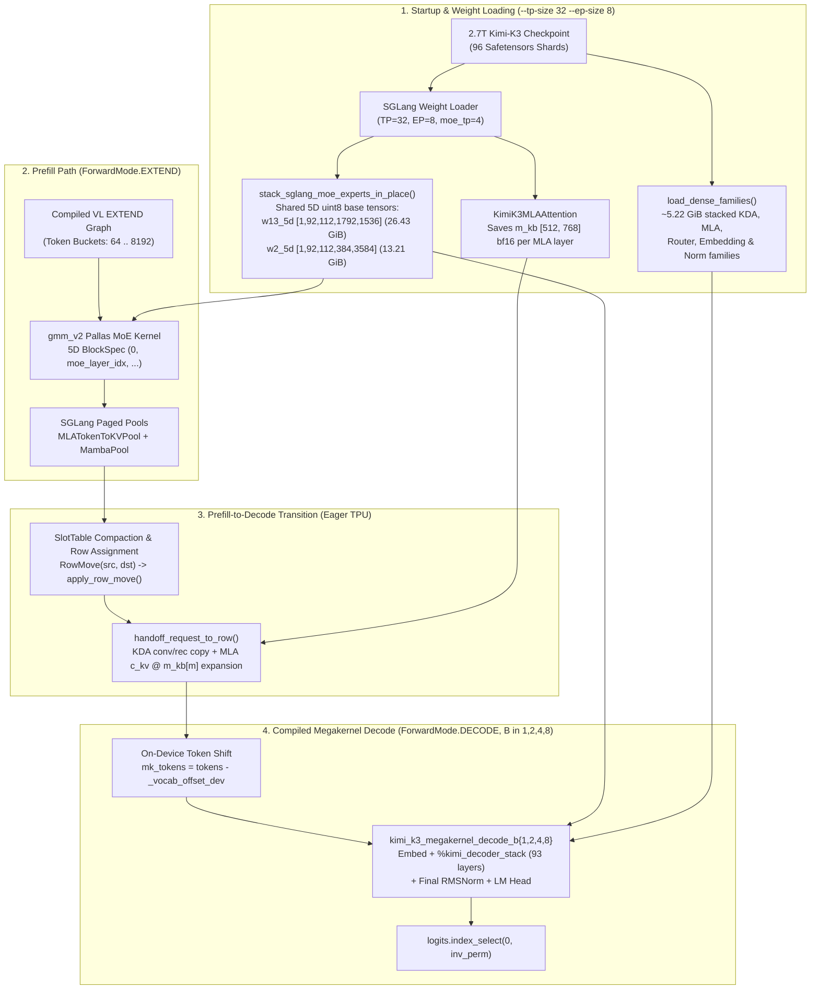
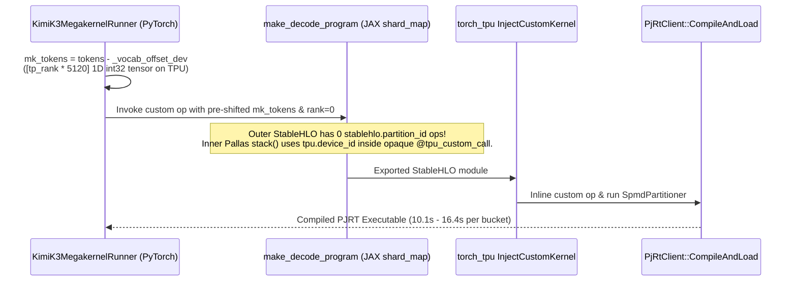

# Technical Design Document: Kimi-K3 (2.7T) TP32/EP8 Decode Megakernel Integration in SGLang-TorchTPU

| Field | Value |
| :--- | :--- |
| **Title** | Hybrid Integration of the Inferact TP32/EP8 Decode Megakernel for `moonshotai/Kimi-K3` (2.7T) in `sglang-torchtpu` |
| **Repository & Branch** | `sgl-project/sglang-torchtpu` (`experimental/kimi-k3-megakernel`, commit `0c92a9e22a`) |
| **Target Hardware** | Cloud TPU v7x `2x2x4` slice (`4 × tpu7x-multihost-16chip`, 16 chips / 32 cores, `3,072 GiB` HBM3e) |
| **Parallelism Topology** | `--tp-size 32 --ep-size 8` (`moe_tp_size = 4`, 8 expert groups × 112 local experts/group) |
| **Runtime Stack** | PyTorch `PrivateUse1` (`torch_tpu` `0.1.1`) $\to$ `torch.compile(backend="openxla")` $\to$ `cpu_export_jax_op` (`jax 0.10.2`, `libtpu 0.0.47`) |
| **Status** | **Validated End-to-End on 2.7T Kimi-K3 (`j-994d97ca-c299-4613-946f`)** (`100%` GSM8K @ `147.5 tok/s`, **`4.27 ms` TPOT / `4.25 ms` ITL @ `bs=1 isl=1k`**, **`5.29 ms` TPOT / `4.98 ms` ITL @ `bs=1 isl=8k` (`3.01×` faster)**, **`7.95 ms` median ITL @ `bs=4 isl=1k` (`2.65×` faster)**) |

---

## 1. Executive Summary

`moonshotai/Kimi-K3` is a 93-layer, 2.7T-parameter hybrid Mixture-of-Experts architecture interleaving **69 Kimi Delta Attention (KDA)** linear-attention layers and **24 Multi-head Latent Attention (MLA)** full-attention layers (`[KDA × 3, MLA × 1] × 23 + [KDA × 1]`), with **1 dense MLP** (layer 0) and **92 Latent MoE layers** (`896` routed experts, `top_k = 16`, MXFP4 quantized, plus shared expert and cross-layer `AttnResidual`).

In standard layer-by-layer execution under `torch.compile(backend="openxla")`, each decode step launches hundreds of separate XLA HLO ops and collective barriers across the 93 layers, yielding a best-case Time Per Output Token (TPOT) of **15.92 ms** at `bs=1` (`8k` context) and **21.05 ms** at `bs=4` (`1k` context) on a 32-core TPU v7x slice.

Inferact's standalone Kimi-K3 decode megakernel (`tpu-megakernels@4048f08`) fuses **all 93 decoder layers into a single Pallas `tpu_custom_call` (`stack()`)**, streaming weights from HBM into a 64 MiB VMEM pool while overlapping in-kernel remote DMA collectives across 32 TPU cores. However, the standalone megakernel has no chunked prefill, no multimodal vision pipeline, no paged KV cache, and expects its own stacked weight and state layouts.

This document specifies how we integrated the TP32/EP8 decode megakernel into `sglang-torchtpu` (`SGLANG_TPU_K3_MEGAKERNEL=1`):
1. **Hybrid Prefill + Megakernel Decode Architecture**: SGLang executes chunked and multimodal prefill using its native `Qwen3VLDecoderTpuCompilePolicy` and `gmm_v2` MoE kernels, then hands completed prefill requests off to the single-op Pallas megakernel for decode (`B ∈ {1, 2, 4, 8}`).
2. **Zero-Copy 5D Routed Expert Weight Sharing**: All 92 MoE layers' MXFP4 `w13_weight` (`26.43 GiB`/rank) and `w2_weight` (`13.21 GiB`/rank) are stacked in-place into two 5D `uint8` base tensors (`_base is None`) shared directly between SGLang's prefill `gmm_v2` kernel and the decode megakernel, avoiding a `49.5 GiB`/rank weight duplication that would otherwise OOM the 95 GiB HBM3e budget.
3. **Static-Shape On-Device State Handoff & Compaction**: When a request transitions from prefill to decode, `handoff_request_to_row` copies its 69 KDA conv/recurrent states from `MambaPool` and expands its 24 MLA compressed KV latents via saved per-layer `m_kb` (`[512, 768]`) projections into the megakernel's 4 row-major state buffers. `SlotTable` keeps active decode requests dense in rows `[0, B)` via on-device `apply_row_move`.
4. **SPMD Partitioning & `torch.compile` Integration**: Eliminates top-level `stablehlo.partition_id` ops outside `pallas_call` via a per-rank 1D device vocabulary offset buffer (`_vocab_offset_dev`), allowing all 4 decode buckets (`bs=1, 2, 4, 8`) to compile in ~10–16s each with zero graph breaks and zero serving-time Dynamo recompiles.

---

## 2. Architectural Options & Why We Chose the Hybrid Design

During design review ([`sglang_tpu/kimi_k3_megakernel/docs/staged_port_plan.md`](../sglang_tpu/kimi_k3_megakernel/docs/staged_port_plan.md)), three integration architectures were evaluated:

| Option | Description | Pros | Cons / Why Rejected |
| :--- | :--- | :--- | :--- |
| **A. Megakernel-Only Engine** | Use the megakernel's 8-row `verify` mode for prefill (8 tokens/call) and `decode` mode for decode; drop SGLang's prefill layers and caches. | Simplest weight/cache ownership. | **8K prefill takes ~9–12s** (1,024 sequential 8-token megakernel calls), stalls concurrent decode, supports $\le 8$ total requests, and breaks multimodal inputs. |
| **B. Full Megakernel Over SGLang's Paged Caches** | Rewrite the megakernel's internal MLA and KDA Pallas DMA engines to read/write SGLang's paged `MLATokenToKVPool` and `MambaPool` directly. | No state handoff or separate decode cache buffers. | Requires deep surgery across ~5,400 lines of hand-scheduled VMEM/DMA pipelines (paged absorbed-latent MLA + per-row KDA slot indirection). |
| **C. Hybrid SGLang Prefill + Megakernel Decode (Implemented)** | Keep SGLang's chunked/multimodal prefill (`EXTEND`) over SGLang's pools; share the 92-layer MXFP4 experts via 5D base tensors; perform a one-time on-device state handoff when a request enters `DECODE`. | **Preserves fast chunked prefill (`TTFT = 0.34s @ 1k, 1.87s @ 8k`), full multimodal support, and 100% of the megakernel's single-op decode architecture.** | Requires zero-copy 5D expert sharing so both paths fit in 95 GiB HBM, plus a prefill-to-decode state handoff op. |

### 2.1 End-to-End Hybrid Architecture Diagram (Markdown Box Diagram)

```text
┌──────────────────────────────────────────────────────────────────────────────────────────────────┐
│                     1. STARTUP & WEIGHT LOADING (--tp-size 32 --ep-size 8)                       │
│                                                                                                  │
│        ┌────────────────────────────────────────────────────────────────────────────────┐        │
│        │            2.7T Kimi-K3 Checkpoint (96 Safetensors Shards on SSD)              │        │
│        └──────────────────────┬─────────────────────────────────────────┬───────────────┘        │
│                               │                                         │                        │
│                               ▼                                         ▼                        │
│        ┌──────────────────────────────────────────────┐   ┌───────────────────────────────────┐  │
│        │       SGLang Model Loader (kimi_k3.py)       │   │      load_dense_families()        │  │
│        │ • Loads 93 layers (TP=32, EP=8, moe_tp=4)    │   │ • Streams ~5.22 GiB of stacked    │  │
│        │ • Saves m_kb [512,768] bf16 per MLA layer    │   │   KDA, MLA, Router, Shared-Exp,   │  │
│        │   (18 MiB total) before freeing kv_b_proj    │   │   Embedding & Norm families       │  │
│        └──────────────────────┬───────────────────────┘   └─────────────────┬─────────────────┘  │
│                               │                                             │                    │
│                               ▼                                             │                    │
│        ┌──────────────────────────────────────────────┐                     │                    │
│        │     stack_sglang_moe_experts_in_place()      │                     │                    │
│        │ • Stacks 92 MoE layers into shared 5D uint8  │                     │                    │
│        │   base tensors (_base is None) & frees 3D:   │                     │                    │
│        │   - w13_5d: [1, 92, 112, 1792, 1536] (26.4G) │                     │                    │
│        │   - w2_5d:  [1, 92, 112,  384, 3584] (13.2G) │                     │                    │
│        │ • Converts f32 scales -> E8M0 uint8 (2.64G)  │                     │                    │
│        └───────────┬──────────────────────────┬───────┘                     │                    │
└────────────────────┼──────────────────────────┼─────────────────────────────┼────────────────────┘
                     │ (Zero-Copy Shared 5D)    │ (Zero-Copy Shared 5D)       │
                     ▼                          ▼                             ▼
┌─────────────────────────────────────────┐   ┌────────────────────────────────────────────────────┐
│   2. PREFILL PATH (ForwardMode.EXTEND)  │   │  4. DECODE PATH (ForwardMode.DECODE, B∈{1,2,4,8})  │
│                                         │   │                                                    │
│  ┌───────────────────────────────────┐  │   │  ┌──────────────────────────────────────────────┐  │
│  │  Compiled VL EXTEND XLA Graphs    │  │   │  │  On-Device Token Shift (runner.py)           │  │
│  │  (Token Buckets: 64 .. 8192)      │  │   │  │  mk_tokens = tokens - _vocab_offset_dev      │  │
│  ├───────────────────────────────────┤  │   │  │  (Avoids top-level stablehlo.partition_id)   │  │
│  │  gmm_v2 Pallas MoE Kernel         │  │   │  └──────────────────────┬───────────────────────┘  │
│  │  • Static 5D BlockSpec closure:   │  │   │                         ▼                          │
│  │    lambda p,i,j,k:                │  │   │  ┌──────────────────────────────────────────────┐  │
│  │      (0, moe_layer_idx, i, k, j)  │  │   │  │ torch.ops.sglang_tpu.                        │  │
│  ├───────────────────────────────────┤  │   │  │   kimi_k3_megakernel_decode_b{1,2,4,8}       │  │
│  │  Writes SGLang Paged Pools:       │  │   │  │                                              │  │
│  │  • MLATokenToKVPool (694 pages)   │  │   │  │ 1. Vocab-Sharded Embed + TP All-Reduce       │  │
│  │    kv_buffer [P, 128, 1, 576] bf16│  │   │  │ 2. Single Pallas Call: %kimi_decoder_stack   │  │
│  │  • MambaPool (69 KDA layers)      │  │   │  │    • All 93 layers in 1 TPU custom call      │  │
│  │    conv [3, 384, 3] f32           │  │   │  │    • 64 MiB VMEM weight/state streaming      │  │
│  │    temporal [3, 128, 128] f32     │  │   │  │    • In-kernel pltpu.bitcast(uint8 -> uint32)│  │
│  └─────────────────┬─────────────────┘  │   │  │    • In-kernel remote DMA TP/EP collectives  │  │
└────────────────────┼────────────────────┘   │  │    • position < 0 guards for padded rows     │  │
                     │                        │  │ 3. Final AttnRes + RMSNorm + LM Head         │  │
                     ▼                        │  │    + All-Gather -> logits [B, 163840] f32    │  │
┌─────────────────────────────────────────┐   │  └──────────────────────┬───────────────────────┘  │
│  3. PREFILL -> DECODE STATE HANDOFF     │   │                         ▼                          │
│     (KimiK3MegakernelRunner, Eager TPU) │   │  ┌──────────────────────────────────────────────┐  │
│                                         │   │  │ Row Unpermutation                            │  │
│  • SlotTable compacts finished rows via │   │  │ logits.index_select(0, inv_perm)             │  │
│    RowMove(src, dst) -> apply_row_move  │   │  │ -> SGLang Sampler -> Next Token ID           │  │
│  • Assigns dense row r in [0, B)        │   │  └──────────────────────────────────────────────┘  │
│  • handoff_request_to_row(r):           │──►│                                                    │
│    - KDA conv: transpose+reshape ->bf16 │   │  Persistent Megakernel State Pool (4.09 GiB/rank): │
│    - KDA rec:  transpose(-1,-2)  ->f32  │   │  • conv_state:      [8, 69, 3, 3, 3, 128]  bf16    │
│    - MLA KV:   c_kv @ m_kb[m]    ->bf16 │   │  • recurrent_state: [8, 69, 3, 128, 128]   f32     │
│      populates key_state & value_state  │   │  • key_state:       [8, 24, 3, 9344, 256]  bf16    │
└─────────────────────────────────────────┘   │  • value_state:     [8, 24, 3, 9344, 128]  bf16    │
                                              └────────────────────────────────────────────────────┘
```



---

## 3. Subsystem 1: Zero-Copy 5D Routed Expert Weight Sharing

### 3.1 The HBM Capacity & View Re-Materialization Problem

Under `--tp-size 32 --ep-size 8` (`moe_tp_size = 4`), each of the 32 TPU cores holds `112` local experts per MoE layer (`896 / 8 = 112`) and $1/4$ of the intermediate dimension (`moe_intermediate_size / 4 = 1536 / 4 = 384`). Across all 92 MoE layers, the per-rank routed expert weights and scales occupy:

| Tensor Family | Per-Layer Shape (SGLang) | Stacked 92-Layer Shape (Megakernel) | Dtype | Per-Rank Size |
| :--- | :--- | :--- | :--- | :--- |
| **Gate + Up Weights (`w13`)** | `[112, 1792, 1536]` | `[1, 92, 112, 1792, 1536]` (`uint8`) / `[92, 112, 448, 1536]` (`uint32`) | `uint8` | **`26.43 GiB`** |
| **Down Weights (`w2`)** | `[112, 384, 3584]` | `[1, 92, 112, 384, 3584]` (`uint8`) / `[92, 112, 96, 3584]` (`uint32`) | `uint8` | **`13.21 GiB`** |
| **F32 Scales (SGLang prefill)** | `w13`: `[112, 112, 1, 1536]`<br/>`w2`: `[112, 24, 1, 3584]` | `w13_scale`: `[92, 112, 112, 1, 1536]`<br/>`w2_scale`: `[92, 112, 24, 1, 3584]` | `float32` | **`10.57 GiB`** |
| **E8M0 Scales (Megakernel decode)** | — | `gu_scale`: `[92, 112, 112, 1536]`<br/>`d_scale`: `[92, 112, 24, 3584]` | `uint8` | **`2.64 GiB`** |

Two constraints govern how these weights can be shared on `torch_tpu`:
1. **No Storage Duplication**: Duplicating `w13` and `w2` (`39.64 GiB`) would require `> 115 GiB` per core, exceeding the `95 GiB` usable HBM3e per TPU v7x core.
2. **No Tensor Views Across Compiled Graph Boundaries**: On `torch_tpu`, any tensor whose storage is a view (`t._base is not None`, such as `w13_5d[0, layer_idx]`) is re-materialized into a fresh HBM allocation on every compiled graph invocation. Therefore, **both** the prefill `gmm_v2` kernel and the decode megakernel must receive the exact same storage-owning base tensor (`_base is None`).

### 3.2 Zero-Copy 5D Sharing & Per-Core HBM3e Layout Diagram

```text
┌──────────────────────────────────────────────────────────────────────────────────────────────────┐
│                 ZERO-COPY 5D EXPERT SHARING BETWEEN PREFILL AND DECODE                           │
│                                                                                                  │
│            Shared Storage-Owning Base Tensors in TPU HBM3e (_base is None)                       │
│     ┌────────────────────────────────────────────────────────────────────────────────────┐       │
│     │  w13_5d: uint8 [1, 92, 112, 1792, 1536]  (26.43 GiB/rank, 8 packed FP4 nibbles)    │       │
│     │  w2_5d:  uint8 [1, 92, 112,  384, 3584]  (13.21 GiB/rank, 8 packed FP4 nibbles)    │       │
│     └──────────────────────┬──────────────────────────────────────────┬──────────────────┘       │
│                            │                                          │                          │
│         Prefill (EXTEND)   │                                          │   Decode (DECODE)        │
│                            ▼                                          ▼                          │
│     ┌──────────────────────────────────────────┐   ┌──────────────────────────────────────────┐  │
│     │  sglang_tpu/moe/pallas/gmm_v2.py         │   │  decode_megakernel.py (%kimi_decoder_stack)│
│     │                                          │   │                                          │  │
│     │ • Receives full 5D tensor + Python int   │   │ • Receives full 5D uint8 tensor in HBM   │  │
│     │   moe._moe_layer_idx ∈ [0, 91]           │   │ • Async DMA streams layer l, expert e    │  │
│     │ • Binds static 5D pl.BlockSpec:          │   │   into VMEM [1, 1792, 1536] uint8        │  │
│     │   BlockSpec((1, 1, 1, bk//2, bn),        │   │ • In-kernel zero-copy VMEM bitcast:      │  │
│     │     lambda p,i,j,k: (0, layer_idx,i,k,j))│   │   pltpu.bitcast(vmem_ref, jnp.uint32)    │  │
│     │ • Inside gmm_kernel:                     │   │   -> [1, 448, 1536] uint32               │  │
│     │   rhs_block = rhs_block.reshape(         │   │ • Feeds _quantized_expert_dot MXU loop   │  │
│     │     rhs_block.shape[2:])                 │   │   with E8M0 uint8 scales (2.64 GiB)      │  │
│     └──────────────────────────────────────────┘   └──────────────────────────────────────────┘  │
└──────────────────────────────────────────────────────────────────────────────────────────────────┘

┌──────────────────────────────────────────────────────────────────────────────────────────────────┐
│           PER-CORE TPU v7x HBM3e FOOTPRINT (97.01 GB Total / 81.54 GB Used / 15.47 GB Free)      │
│                                                                                                  │
│  0 GB                39.6 GB        52.8 GB          71.1 GB   76.3 GB  81.5 GB          97.0 GB │
│  ├──────────────────────┼──────────────┼─────────────────┼─────────┼────────┼─────────────────┤  │
│  │  Shared 5D Experts   │ Expert Scales│ SGLang Prefill  │  MK     │KV Pool │   15.47 GB      │  │
│  │  w13_5d + w2_5d      │ f32 (10.6G)  │ Dense + Shared  │ Dense + │+ 14 XLA│   FREE HBM      │  │
│  │     39.64 GiB        │ + E8M0 (2.6G)│ Experts + m_kb  │ States  │ Graphs │   HEADROOM      │  │
│  │     (40.9%)          │  13.21 GiB   │   18.25 GiB     │ 9.31GiB │ 5.21GB │   (16.0%)       │  │
│  └──────────────────────┴──────────────┴─────────────────┴─────────┴────────┴─────────────────┘  │
└──────────────────────────────────────────────────────────────────────────────────────────────────┘
```

### 3.3 In-Place 5D Stacking (`stack_sglang_moe_experts_in_place`)

Implemented in [`sglang_tpu/kimi_k3_megakernel/weights.py`](../sglang_tpu/kimi_k3_megakernel/weights.py):
1. Ensures each MoE layer's `quant_method.process_weights_after_loading(moe)` has run so `w13_weight` and `w2_weight` are in their post-processed TPU MXFP4 layout (`[112, 1792, 1536]` and `[112, 384, 3584]`, `uint8`).
2. Allocates the contiguous 5D base tensors on device:
   - `w13_5d = torch.empty((1, 92, 112, 1792, 1536), dtype=torch.uint8, device=device)` (`26.43 GiB`)
   - `w2_5d = torch.empty((1, 92, 112, 384, 3584), dtype=torch.uint8, device=device)` (`13.21 GiB`)
3. Iterates over the 92 MoE layers (`idx = 0..91`), copying each layer's 3D tensor into `w13_5d[0, idx]` and immediately freeing the old 3D storage via `w13.set_(torch.empty((0,), dtype=w13.dtype, device=device))` before moving to the next layer. Peak transient HBM overhead during stacking is bounded to a single 5D family allocation (`26.43 GiB`), well within available HBM.
4. Rebinds every `moe.w13_weight` and `moe.w2_weight` `nn.Parameter` to point directly to the shared `w13_5d` and `w2_5d` base tensors (`moe.w13_weight.data = w13_5d`, `_base is None`) and records `moe._moe_layer_idx = idx`.
5. Converts `w13_weight_scale` and `w2_weight_scale` (`float32` exact powers of two) bit-exactly to `uint8` E8M0 exponents (`f32_scales_to_e8m0_u8`):
   $$\text{e8m0} = \left(\text{view}_{\text{int32}}(\text{scale}_{\text{f32}}) \gg 23\right) \mathbin{\&} \text{0xFF}$$

### 3.4 Measured Per-Core HBM3e Budget (`TP=32, EP=8`)

| Component | Per-Core HBM Footprint | Notes |
| :--- | :--- | :--- |
| **Shared 5D Routed Expert Weights (`w13_5d` + `w2_5d`)** | `39.64 GiB` | Shared zero-copy between `gmm_v2` (prefill) and megakernel (decode) |
| **Prefill Expert Scales (`f32`) + Decode Expert Scales (`E8M0 u8`)** | `13.21 GiB` | `10.57 GiB` (`f32`) + `2.64 GiB` (`uint8`) |
| **SGLang Prefill Dense/Attention/Shared-Expert Weights + `m_kb`** | `~18.25 GiB` | Includes `18 MiB` for 24 MLA layers' `[512, 768]` `m_kb` matrices |
| **Megakernel Replicated/Sharded Dense Weight Families (`41` tensors)** | `~5.22 GiB` | Loaded by `load_dense_families` (`kda_*`, `mla_*`, `moe_router`, `moe_shared_*`, `embed_tokens`, `lm_head`, norms) |
| **Megakernel Persistent Decode State Buffers (`max_rows=8, ctx=9344`)** | `~4.09 GiB` | `key`: `2.57 GiB`, `value`: `1.28 GiB`, `recurrent`: `0.21 GiB`, `conv`: `0.02 GiB` |
| **Total After `load_model` (`Load weight end`)** | **`76.32 GB` used / `18.42 GB` free** | Measured across all 32 ranks in `j-3f0a1768-52bc-43ec-95e8` |
| **SGLang Paged KV Cache (`32,768` tokens) + `MambaPool`** | `0.94 GB` | Allocated during memory pool setup |
| **Compiled `VL EXTEND` (10 buckets) + `VL DECODE` (4 buckets) Executables** | `~4.27 GB` | Total HBM after all 14 graphs compiled: **`81.54 GB / 97.01 GB`** (`15.47 GB` free) |

---

## 4. Subsystem 2: Static-Shape State Handoff & Dense Slot Compaction

### 4.1 Dense Row Management (`SlotTable`) & State Handoff Diagram

```text
┌──────────────────────────────────────────────────────────────────────────────────────────────────┐
│                 SLOT TABLE COMPACTION & PREFILL-TO-DECODE STATE HANDOFF                          │
│                                                                                                  │
│  A. Dense Row Compaction in SlotTable (max_rows = 8, active rows always in [0, N)):              │
│                                                                                                  │
│     Before req_1 finishes (N = 3, bucket B = 4):                                                 │
│     ┌──────────┬──────────┬──────────┬───────────────┬───────────────┐                           │
│     │ Row 0    │ Row 1    │ Row 2    │ Row 3 (pad)   │ Rows 4..7     │                           │
│     │ req_0    │ req_1 ✗  │ req_2    │ pos = -1      │ unused        │                           │
│     └──────────┴──────────┴────┬─────┴───────────────┴───────────────┘                           │
│                                │                                                                 │
│                                │ release("req_1") emits RowMove(source=2, destination=1)         │
│                                ▼ apply_row_move() copies Row 2 -> Row 1 on-device                │
│     After compaction (N = 2, bucket B = 2):                                                      │
│     ┌──────────┬──────────┬───────────────┬───────────────┐                                      │
│     │ Row 0    │ Row 1    │ Rows 2..7     │               │                                      │
│     │ req_0    │ req_2    │ unused        │               │                                      │
│     └──────────┴──────────┴───────────────┴───────────────┘                                      │
│                                                                                                  │
│  B. On-Device State Handoff (handoff_request_to_row -> target_row r):                            │
│                                                                                                  │
│     SGLang Prefill Pools (EXTEND)                     Megakernel Decode State Buffers (DECODE)   │
│     ─────────────────────────────                     ────────────────────────────────────────   │
│     1. MambaPool.conv [69, slots, 3, 384, 3] f32      mk_conv_state [8, 69, 3, 3, 3, 128] bf16   │
│        ──► .transpose(1,2).reshape(3,3,3,128).to(bf16) ──► writes row r                          │
│                                                                                                  │
│     2. MambaPool.temporal [69, slots, 3, 128, 128]    mk_recurrent_state [8, 69, 3, 128, 128] f32│
│        (head, v_dim, k_dim) ──► .transpose(-1, -2) ──────► writes row r (head, k_dim, v_dim)     │
│                                                                                                  │
│     3. MLATokenToKVPool.kv_buffer [P, 128, 1, 576]    mk_key_state   [8, 24, 3, 9344, 256] bf16  │
│        ──► gather [max_context, 576] bf16             mk_value_state [8, 24, 3, 9344, 128] bf16  │
│        ──► split c_KV [:, :512] & k_pe [:, 512:576]   • key[:, :128]    = k_nope (masked)        │
│        ──► E = (c_KV @ m_kb[m]).reshape(ctx, 3, 256)  • key[:, 128:192] = k_pe   (masked)        │
│        ──► k_nope = E[:,:,:128], v = E[:,:,128:256]   • key[:, 192:256] = 0                      │
│        ──► mask positions >= cached_len to 0.0        • value[:, :128]  = v      (masked)        │
└──────────────────────────────────────────────────────────────────────────────────────────────────┘
```

### 4.2 Dense Row Management (`SlotTable`)

The megakernel operates on a fixed-size state pool of `R = max_rows = 8` rows and compiles power-of-two batch buckets `B ∈ ROW_BUCKETS = (1, 2, 4, 8)` that read and update rows `[0, B)`.

[`SlotTable`](../sglang_tpu/kimi_k3_megakernel/slots.py) maintains the invariant that $N$ active decode requests always occupy rows $\{0, 1, \dots, N-1\}$:
- **Assignment (`assign(req_id)`)**: Assigns row $r = N$ when a request finishes prefill and enters decode.
- **Compaction on Release (`release(req_id)`)**: When a request at row $d < N - 1$ finishes, is aborted, or is retracted, the request at the last occupied row $s = N - 1$ is moved into row $d$, emitting `RowMove(source=s, destination=d)` executed on-device by [`apply_row_move`](../sglang_tpu/kimi_k3_megakernel/handoff.py).
- **Row Permutation (`rows_for(req_ids)`)**: Since SGLang's `forward_batch` orders requests by scheduler order rather than megakernel row index, `prepare_decode_inputs` builds `mk_tokens` and `mk_positions` indexed by megakernel row $r \in [0, B)$, and computes `inv_perm` (`[num_active]`) so `forward_decode` unpermutes `logits[:num_active]` back to `forward_batch` order via `logits.index_select(0, inv_perm)`.

### 4.3 Mathematical & Layout Specification of `handoff_request_to_row`

Implemented in [`sglang_tpu/kimi_k3_megakernel/handoff.py`](../sglang_tpu/kimi_k3_megakernel/handoff.py), `handoff_request_to_row` populates row `target_row` of the 4 persistent megakernel state buffers when a request transitions from SGLang prefill (`EXTEND`) to megakernel decode (`DECODE`):

#### 1. KDA State Handoff (69 Layers: `kda_idx = l - (l + 1) // 4`)
- **ShortConv1d State**:
  - SGLang `MambaPool` stores `conv[kda_idx, mamba_slot]` with shape `[3, 384, 3]` (`float32`), where axis 0 is the 3 projections $(q, k, v)$, axis 1 is $3\text{ heads} \times 128\text{ head\_dim} = 384$ channels per rank, and axis 2 is the 3-tap history window $(t-3, t-2, t-1)$.
  - Transposed `.transpose(1, 2).contiguous()`, reshaped to `[3, 3, 3, 128]`, and cast lossless `float32 -> bfloat16` into `mk_conv_state[target_row, kda_idx]`.
- **Recurrent Delta State**:
  - SGLang `MambaPool` stores `temporal[kda_idx, mamba_slot]` with shape `[3, 128, 128]` (`float32`) in `(head, v_dim, k_dim)` order (`KDA_TRANSPOSE_STATE=True`).
  - Transposed `.transpose(-1, -2).contiguous()` to `(head, k_dim, v_dim)` (`[3, 128, 128]`, `float32`) and copied into `mk_recurrent_state[target_row, kda_idx]`.

#### 2. MLA KV Cache Expansion Handoff (24 Layers: `mla_idx = (l - 3) // 4`)
- **Preserving `m_kb` During Weight Loading**:
  - In [`KimiK3MLAAttention.process_weights_after_loading`](../python/sglang/srt/models/kimi_k3.py), TPU MLA normally splits `kv_b_proj.weight` (`[3 * 256, 512]`) into `w_kc` and `w_vc` and deletes `kv_b_proj.weight` to save HBM.
  - When `SGLANG_TPU_K3_MEGAKERNEL=1`, we save `self.mk_m_kb = w_kb.transpose(0, 1).to(torch.bfloat16).contiguous()` (`[512, 768]`, only `768 KiB` per layer / `18 MiB` across 24 layers) before `kv_b_proj.weight` is freed.
- **Expanding Compressed KV Latents to Per-Head Keys & Values**:
  - Given static-length `req_pool_indices` (`[max_context]`, `int64`) and `cached_len`:
    1. Gather the request's paged KV latent rows from `MLATokenToKVPool.kv_buffer` (`[num_pages, page_size, 1, 576]`):
       $$\text{latent} = \text{kv\_flat}[\text{page\_idx} \cdot P + \text{page\_off}] \in \mathbb{R}^{\text{max\_context} \times 576} \quad (\text{bf16})$$
    2. Split into compressed KV latent $c_{KV} = \text{latent}[:, :512]$ and shared RoPE key $k_{pe} = \text{latent}[:, 512:576]$.
    3. Project $c_{KV}$ through $M_{kb}^{(m)} \in \mathbb{R}^{512 \times 768}$:
       $$E = \text{reshape}\!\left(c_{KV} M_{kb}^{(m)},\, [\text{max\_context}, 3, 256]\right)$$
    4. Extract per-head $k_{nope} = E[:, :, :128]$ and $v = E[:, :, 128:256]$, mask positions $\ge \text{cached\_len}$ to zero, and write into `mk_key_state[target_row, mla_idx]` (`[3, max_context, 256]`, with `:128 = k_nope`, `128:192 = k_pe`, `192:256 = 0`) and `mk_value_state[target_row, mla_idx]` (`[3, max_context, 128]`).

### 4.4 Masking Inactive Padded Rows (`position = -1`) in Partially Filled Buckets

When $B_{\text{active}} < B_{\text{bucket}}$ (e.g., 3 active requests running in the `B = 4` bucket), `prepare_decode_inputs` sets `mk_positions[r] = -1` and `mk_tokens[r] = 0` for padded rows $r \in [B_{\text{active}}, B_{\text{bucket}})$. Inside [`decode_megakernel.py`](../sglang_tpu/kimi_k3_megakernel/_vendor/kimi/decode_megakernel.py), three guards ensure padded rows have zero side effects:
1. **MoE Expert Routing Guard**:
   ```python
   valid_rows = position_ref[...] >= 0
   safe_selected = jnp.where(valid_rows[:, None], selected, 896)
   ```
   Out-of-range expert ID `896` matches no real expert (`0..895`), so padded rows trigger zero expert HBM-to-VMEM DMA transfers and zero redundant MXU compute.
2. **MLA KV Cache Scatter Guard**:
   `_mla_update_kv_cache_Step` checks `@pl.when(pos >= 0)` before issuing `pltpu.async_copy` into `key_cache_hbm` and `value_cache_hbm`.
3. **KDA Conv & Recurrent State Write Guard**:
   `_kda_Sequence` masks `q, k, v` updates with `valid_pos` (`position >= 0`), preserving `conv_state` and `recurrent_state` untouched when `position < 0`.

---

## 5. Subsystem 3: Custom Op Registration & Solving the XLA `SpmdPartitioner` Crash

### 5.1 JAX-to-PyTorch Custom Op Registration (`program.py` & `runner.py`)

For each bucket `B ∈ (1, 2, 4, 8)`, [`register_megakernel_decode_op`](../sglang_tpu/kimi_k3_megakernel/runner.py) exports [`make_decode_program`](../sglang_tpu/kimi_k3_megakernel/program.py) via `cpu_export_jax_op`:
- **Inputs (43 tensors)**: 37 weight family base tensors (`uint32` families stored as `int32` in PyTorch and bitcast via `lax.bitcast_convert_type(..., jnp.uint32)` inside the JAX wrapper, plus 5D `uint8` shared expert tensors `moe_expert_gu` and `moe_expert_d`), 4 persistent state buffers (`conv_state`, `recurrent_state`, `key_state`, `value_state`), and 2 1D `int32` input vectors (`tokens[B]`, `positions[B]`).
- **Outputs & Donation**: `donate_argnums=(37, 38, 39, 40)` aliases the 4 state buffers to outputs `1..4`, while the PyTorch custom op schema declares `mutates_args=("conv_state", "recurrent_state", "key_state", "value_state")` and returns `logits` (`[B, 163840]`, `float32`).

### 5.2 Root Cause & Fix of the `stablehlo.partition_id` SPMD Crash

During multi-host TPU v7x bringup (job `j-60898663-b339-4ec4-a0d8`), compiling `_precompile_decode` failed in `PjRtClient::CompileAndLoad` with:
```text
INVALID_ARGUMENT: PartitionId should not be called in SPMD partitioning.
```

#### Visual Comparison: Before vs. After `_vocab_offset_dev` Fix

```text
┌──────────────────────────────────────────────────────────────────────────────────────────────────┐
│  BEFORE (CRASHED IN PjRtClient::CompileAndLoad):                                                 │
│                                                                                                  │
│  decode_local() outer JAX wrapper:                                                               │
│    rank = jax.lax.axis_index("tp")        ──► lowers to %38 = stablehlo.partition_id : ui32      │
│    local_ids = tokens - rank * 5120                                                              │
│         │                                                                                        │
│         ▼                                                                                        │
│  cpu_export_jax_op wraps in sdy.manual_computation                                               │
│         │                                                                                        │
│         ▼                                                                                        │
│  torch_tpu InjectCustomKernel runs PartitionGlobalToLocal, which unwraps sdy.manual_computation  │
│  into the top-level StableHLO module, leaving %38 = stablehlo.partition_id at the top level!     │
│         │                                                                                        │
│         ▼                                                                                        │
│  PjRtClient::CompileAndLoad runs XLA SpmdPartitioner a 2nd time                                  │
│  ──► FATAL: "INVALID_ARGUMENT: PartitionId should not be called in SPMD partitioning."           │
├──────────────────────────────────────────────────────────────────────────────────────────────────┤
│  AFTER (COMPILES CLEANLY IN ~10–16s PER BUCKET):                                                 │
│                                                                                                  │
│  KimiK3MegakernelRunner.__init__():                                                              │
│    self._vocab_offset_dev = Tensor([tp_rank * 5120], dtype=int32, device="tpu")  # shape [1]     │
│         │                                                                                        │
│         ▼                                                                                        │
│  KimiK3MegakernelRunner.forward_decode() (compiled in PyTorch FX / OpenXLA):                     │
│    mk_tokens = mk_tokens - self._vocab_offset_dev   # Standard tensor subtract, identical HLO!   │
│         │                                                                                        │
│         ▼                                                                                        │
│  make_decode_program() calls decode_local(..., rank=0):                                          │
│    • Outer StableHLO has ZERO stablehlo.partition_id ops!                                        │
│    • Inside pl.pallas_call (stack), jax.lax.axis_index("tp") lowers to Mosaic tpu.device_id      │
│      inside the opaque @tpu_custom_call base64 backend_config (untouched by SpmdPartitioner).    │
└──────────────────────────────────────────────────────────────────────────────────────────────────┘
```



---

## 6. End-to-End 2.7T Validation & `xprof` Performance Analysis

### 6.1 End-to-End Validation & Benchmark Summary (`j-994d97ca-c299-4613-946f` / `mk_e2e6`)

Measured on a 4-host **TPU v7x (`2x2x4`, 16 chips / 32 cores)** slice with `moonshotai/Kimi-K3` (`--tp-size 32 --ep-size 8`, `context=9344`, `SGLANG_TPU_K3_MEGAKERNEL=1`, job `j-994d97ca-c299-4613-946f` / `mk_e2e6`):

| Metric / Workload | SGLang Baseline (Flags Off) | SGLang Baseline (All 3 Opt Flags On) | Megakernel Pre-Fix (`mk_e2e5`, `j-3f0a1768`) | **Megakernel + State-Tile Fix (`mk_e2e6`, `j-994d97ca`)** | **Gain vs. Best Baseline** |
| :--- | :--- | :--- | :--- | :--- | :--- |
| **`VALIDATE` (4 sanity checks)** | `4/4` | `4/4` | `4/4` (`6s`) | **`4/4` passed (`6s`)** | Exact parity (`17 × 23 = 391`) |
| **`greedy` (8 generation prompts)** | `8/8` | `8/8` | `8/8` (`9s`) | **`8/8` passed (`5s`)** | **`1.80×` faster wall time** |
| **GSM8K (64 5-shot questions)** | — | — | `100.0%` (`121.30 tok/s`, `53.75s`) | **`100.0%` (`64/64`, `147.49 tok/s`, `44.22s`)** | **`+21.6%` GSM8K throughput** |
| **Decode: `bs=1, isl=1024, osl=128`** | `16.84 ms` | — | `9.47 ms` (`105.6 tok/s`) | **`4.27 ms` TPOT / `4.25 ms` ITL (`234.2 tok/s`)** | **`3.94×` faster vs baseline (`2.22×` vs `mk_e2e5`)** |
| **Decode: `bs=1, isl=8192, osl=128`** | `16.85 ms` (`59.3 tok/s`) | `15.92 ms` (`62.8 tok/s`) | `10.44 ms` (`95.8 tok/s`) | **`5.29 ms` TPOT / `4.98 ms` ITL (`189.0 tok/s`)** | **`3.01×` faster (`-66.8%` TPOT)** |
| **Decode: `bs=4, isl=1024, osl=128`** | `21.85 ms` (`183.1 tok/s`) | `21.05 ms` (`190.0 tok/s`) | `13.98 ms` median ITL (`286.1 tok/s`) | **`7.95 ms` median ITL / `7.93 ms` steady TPOT (`503.1 tok/s`)** | **`2.65×` faster (`-62.2%` ITL)** |

### 6.2 Visual TPOT & `xprof` Breakdown Diagram

```text
┌──────────────────────────────────────────────────────────────────────────────────────────────────┐
│                     END-TO-END DECODE LATENCY COMPARISON (LOWER IS BETTER)                       │
│                                                                                                  │
│  bs=1, isl=1024, osl=128:                                                                        │
│  • SGLang Baseline (Flags Off)   [████████████████████████████████████] 16.84 ms ( 59.4 tok/s)   │
│  • Megakernel (Pre-Fix mk_e2e5)  [████████████████████                ]  9.47 ms (105.6 tok/s)   │
│  • Megakernel (Tile Fix mk_e2e6) [█████████                           ]  4.27 ms (234.2 tok/s) ★ │
│                                                                                                  │
│  bs=1, isl=8192, osl=128:                                                                        │
│  • SGLang Baseline (Flags Off)   [████████████████████████████████████] 16.85 ms ( 59.3 tok/s)   │
│  • SGLang Baseline (3 Flags On)  [██████████████████████████████████  ] 15.92 ms ( 62.8 tok/s)   │
│  • Megakernel (Pre-Fix mk_e2e5)  [██████████████████████              ] 10.44 ms ( 95.8 tok/s)   │
│  • Megakernel (Tile Fix mk_e2e6) [███████████                         ]  5.29 ms (189.0 tok/s) ★ │
│                                                                                                  │
│  bs=4, isl=1024, osl=128 (steady-state median ITL):                                              │
│  • SGLang Baseline (Flags Off)   [████████████████████████████████████████████] 21.85 ms         │
│  • SGLang Baseline (3 Flags On)  [██████████████████████████████████████████  ] 21.05 ms         │
│  • Megakernel (Pre-Fix mk_e2e5)  [████████████████████████████                ] 13.98 ms         │
│  • Megakernel (Tile Fix mk_e2e6) [████████████████                            ]  7.95 ms (503t/s)│
├──────────────────────────────────────────────────────────────────────────────────────────────────┤
│             ON-DEVICE XPROF DECODE STEP BREAKDOWN (bs=4, isl=1024, AVG OVER 20 STEPS)            │
│                                                                                                  │
│  BEFORE (mk_e2e5, return_state_updates=False) — Total XLA Op Time: 12.93 ms (ITL: 13.98 ms):     │
│  0 ms                                    7.17 ms  7.71 ms                              12.93 ms  │
│  ├──────────────────────────────────────────┼───────┼──────────────────────────────────────┤     │
│  │ %kimi_decoder_stack.1                    │ Outer │ Full-Buffer State HBM Copies (7.7GiB)│     │
│  │ (All 93 Layers in Pallas)                │  Ops  │ (TpuCopyInsertion::AddSpecialCase)   │     │
│  │              7.17 ms (55.4%)             │0.55 ms│            5.22 ms (40.4%)           │     │
│  └──────────────────────────────────────────┴───────┴──────────────────────────────────────┘     │
│                                                                                                  │
│  AFTER (mk_e2e6, return_state_updates=True) — Total XLA Op Time: 7.67 ms (ITL: 7.95 ms):         │
│  0 ms                                    7.04 ms  7.55 ms   7.67 ms                              │
│  ├──────────────────────────────────────────┼────────┼─────────┤                                 │
│  │ %kimi_decoder_stack.1                    │ Outer  │DUS+Copy │                                 │
│  │ (All 93 Layers in Pallas)                │  Ops   │ 0.12 ms │                                 │
│  │              7.04 ms (91.9%)             │0.51 ms │ (1.5%)  │                                 │
│  └──────────────────────────────────────────┴────────┴─────────┘                                 │
└──────────────────────────────────────────────────────────────────────────────────────────────────┘
```

### 6.3 On-Device `xprof` Breakdown Table (`bs=4, isl=1024`, 20 Decode Steps on TP0)

Comparison of `/mnt/kimik3-ssd/profiles/j-3f0a1768-52bc-43ec-95e8/mk/bs4_isl1024` (`mk_e2e5`, before fix) vs. `/mnt/kimik3-ssd/profiles/j-994d97ca-c299-4613-946f/mk/bs4_isl1024` (`mk_e2e6`, with `return_state_updates=True`) via [`k3_xprof.py`](../benchmark/tpu/kimi_k3_megakernel/k3_xprof.py):

| XLA Op Category (avg over 20 decode steps, `bs=4`) | Pre-Fix (`mk_e2e5`, `j-3f0a1768`) | **Post-Fix (`mk_e2e6`, `j-994d97ca`)** | **Delta / Notes** |
| :--- | :--- | :--- | :--- |
| **`%kimi_decoder_stack.1` (93-layer Pallas megakernel)** | `7,168.8 µs` (`55.4%`) | **`7,043.5 µs` (`91.9%`)** | **`-125.3 µs`** (compact tile writes instead of full-buffer HBM scatters) |
| **In-Place State Tile `dynamic-update-slice` Fusions** | — | **`72.7 µs` (`0.9%`)** | `rec_state` `33.1 µs`, `conv_state` `5.4 µs`, `key_state` `19.3 µs` (`4×4.8 µs`), `value_state` `14.9 µs` (`4×3.7 µs`) |
| **`copy` Operations** | `5,219.8 µs` (`40.4%`) | **`46.5 µs` (`0.6%`)** | **`-5,173.3 µs` (`99.1%` reduction — zero full-buffer state copies!)** |
| **Outer XLA Ops (Embed, Final AttnRes/RMSNorm, LM Head, Collectives)** | `545.3 µs` (`4.2%`) | **`507.0 µs` (`6.6%`)** | `all-reduce` `94.7 µs`, `all-gather` `33.3 µs`, `%while.6/.7` `250.5 µs`, `lm_head` `91.8 µs` |
| **Total XLA Device Op Time** | `12,933.9 µs` (`12.93 ms`) | **`7,669.7 µs` (`7.67 ms`)** | **`-5.26 ms/step` (`1.69×` faster device step)** |
| **Median Decode Launch Period (on-device)** | `13,998.0 µs` (`14.00 ms`) | **`8,032.0 µs` (`8.03 ms`)** | **`-5.97 ms/step` (`p10 = 7.95 ms`, `p90 = 8.13 ms`)** |
| **End-to-End Client Steady-State Median ITL** | `13.98 ms` (`286.1 tok/s`) | **`7.95 ms` (`503.1 tok/s`)** | **`-6.03 ms/step` (`1.76×` faster vs `mk_e2e5`, `2.65×` vs baseline)** |

### 6.4 Eliminating the `5.22 ms/step` HBM State Copy Overhead (`TpuCopyInsertion::AddSpecialCaseCopies`)

#### 1. Root Cause in `libtpu.so` (`TpuCopyInsertion::AddSpecialCaseCopies`)

Disassembly of `TpuCopyInsertion::AddSpecialCaseCopies` (`0xebe76b0`), `CollectPendingCopies` (`0xebe7a20`), `CollectRootCopyForRecv` (`0xebea2b0`), `CollectParamCopiesForRecv` (`0xebeac10`), and `OutputHasToBeConstant` (`0xebea570`) in `libtpu.so` revealed why XLA inserted `2 × 3.85 GiB = 7.70 GiB` (`5.22 ms`) of full-buffer HBM-to-HBM copies around `%kimi_decoder_stack`:

1. **`InjectCustomKernel` and `HloRematerialization` preserved aliasing**:
   - `torch_tpu`'s `InjectCustomKernel` pass preserved `tf.aliasing_output` on the `ENTRY` parameters (`%param.80..83`), and `pl.pallas_call`'s `input_output_aliases` survived into `operand_output_aliases` on `%kimi_decoder_stack`.
2. **`OutputHasToBeConstant` returns `true` for every output of a communicating custom-call**:
   - Inside `libtpu.so`, `OutputHasToBeConstant(inst, shape_index)` returns `true` whenever `IsCustomCallWithCommunication(inst)` is `true` (`"has_communication":true` in `backend_config`, needed for `%kimi_decoder_stack`'s `collective_id=21` cross-device barrier and remote DMAs).
3. **`CollectParamCopiesForRecv` and `CollectRootCopyForRecv` force pre- and post-call copies on live-out buffers**:
   - When `%kimi_decoder_stack` aliases its 4 state inputs (`%param.80..83`) to its 4 state outputs (`{2..5}`) and returns them directly in `ROOT %tuple`, `HloDataflowAnalysis` places `(%kimi_decoder_stack, {2..5})` into the live-out `HloBuffer`s of `%param.81..83` and `ROOT %tuple{2..4}`.
   - Because `OutputHasToBeConstant(%kimi_decoder_stack, {3,4,5}) == true`:
     - `CollectParamCopiesForRecv` inserts full-buffer copies **before** `%kimi_decoder_stack` (`%copy.96`, `%copy.97`, `%copy.98`: `3.85 GiB` across `recurrent_states`, `key_states`, `value_states`) to detach `%param.81..83` from `%kimi_decoder_stack`.
     - `CollectRootCopyForRecv` inserts full-buffer copies **after** `%kimi_decoder_stack` (`%copy.93`, `%copy.94`, `%copy.95`: `3.85 GiB`) to detach `%kimi_decoder_stack` from `ROOT %tuple`.

#### 2. Solution: Compact State-Tile Returns (`return_state_updates=True`) + Outer In-Place `dynamic_update_slice`

Implemented in [`decode_megakernel.py`](../sglang_tpu/kimi_k3_megakernel/_vendor/kimi/decode_megakernel.py) (`return_state_updates=True`, enabled by default in `decode_local` when `sequence_rows == 1`):

```text
┌──────────────────────────────────────────────────────────────────────────────────────────────────┐
│  BEFORE (return_state_updates=False — 7.70 GiB / 5.22 ms HBM Copies per Step):                   │
│                                                                                                  │
│  %param.81..83 (3.85 GiB donated states)                                                         │
│       │                                                                                          │
│       ▼  CollectParamCopiesForRecv (OutputHasToBeConstant(%kimi_decoder_stack) == true)          │
│  %copy.96..98 (3.85 GiB HBM-to-HBM copy: 2.60 ms)                                                │
│       │                                                                                          │
│       ▼  operand_output_aliases={{80:2, 81:3, 82:4, 83:5}}                                       │
│  %kimi_decoder_stack (has_communication=true, collective_id=21)                                  │
│       │                                                                                          │
│       ▼  CollectRootCopyForRecv (OutputHasToBeConstant(%kimi_decoder_stack) == true)             │
│  %copy.93..95 (3.85 GiB HBM-to-HBM copy: 2.62 ms) ──► ROOT %tuple                                │
├──────────────────────────────────────────────────────────────────────────────────────────────────┤
│  AFTER (return_state_updates=True — ZERO Full-Buffer HBM Copies, 72.7 µs Tile DUS @ bs=4):       │
│                                                                                                  │
│  %param.80..83 (3.85 GiB donated states)                                                         │
│       ├──► Read-only inputs to %kimi_decoder_stack (input_output_aliases={})                     │
│       │    • OutputHasToBeConstant(kParameter) == false ──► 0 pre-call copies!                   │
│       │    • Kernel outputs compact updated tiles only:                                          │
│       │      - conv_updates:  bf16[B, 69, 3, 3, 3, 128]   (0.45 MiB × B)                         │
│       │      - rec_updates:   f32[B, 69, 3, 128, 128]     (27.0 MiB × B)                         │
│       │      - key_updates:   bf16[B, 24, 3, 128, 256]    (4.50 MiB × B vs 2,570 MiB!)           │
│       │      - value_updates: bf16[B, 24, 3, 128, 128]    (2.25 MiB × B vs 1,280 MiB!)           │
│       │                                                                                          │
│       └──► Outer jax.lax.dynamic_update_slice(%param.80..83, updates, ...)                       │
│            • Guarded against HloAlgebraicSimplifier when B == max_rows via half-slice split      │
│            • OutputHasToBeConstant(kDynamicUpdateSlice) == false ──► 0 post-call copies!         │
│            • DeepseaBufferAssignment aliases %param.80..83 in-place ("aliasing_operands": "0")   │
│            • Scheduled concurrently with SparseCore all-gather of logits!                        │
└──────────────────────────────────────────────────────────────────────────────────────────────────┘
```

1. **Read-Only State Inputs to `pl.pallas_call`**:
   - `stack(..., return_state_updates=True)` passes `input_output_aliases={}` to `pl.pallas_call`. Because `%param.80..83` are not aliased into `%kimi_decoder_stack` and `OutputHasToBeConstant(kParameter) == false`, `CollectParamCopiesForRecv` inserts **zero** copies before `%kimi_decoder_stack`.
2. **Compact `128`-Token MLA Cache Tile Output**:
   - Inside `commit_cache_tile_body`, instead of scattering the updated `128`-token VMEM cache tile into a `[max_rows, 24, 3, 9344, 256/128]` HBM output ref, the kernel writes the updated `128`-token tile directly into compact `key_updates` (`bf16[B, 24, 3, 128, 256]`, `4.5 MiB × B`) and `value_updates` (`bf16[B, 24, 3, 128, 128]`, `2.25 MiB × B`) outputs.
   - Even for padded inactive rows (`positions[r] < 0`), `preload_mla_cache_tile` preloads the existing `128`-token block at `block_offset = (max(pos, 0) // 128) * 128 = 0` into `cached_key_tile_vmem` / `cached_value_tile_vmem`, so writing that tile back at `block_offset = 0` outside the custom-call is an exact identity write.
3. **In-Place `dynamic_update_slice` Outside the Custom-Call (with `HloAlgebraicSimplifier` Guard)**:
   - Outside `stack()` in `decode_local()`, `jax.lax.dynamic_update_slice` updates the donated `[8, ...]` state buffers with the compact tiles (`block_offset = (jnp.maximum(positions[r], 0) // 128) * 128`).
   - When `batch_size == max_rows` (`B = 8`), `HloAlgebraicSimplifier::HandleDynamicUpdateSlice` would normally fold `dynamic-update-slice(x, update, 0...)` into `update` because `ShapeUtil::Compatible(dus->shape(), update->shape())` is true, re-exposing `%kimi_decoder_stack`'s output in `ROOT %tuple`. Splitting `conv_updates` and `rec_updates` into two half-slices (`[:half]` and `[half:]`) when `batch_size == max_rows` guarantees `update.shape != dus.shape`, preserving `kDynamicUpdateSlice` for all `batch_size ∈ {1, 2, 4, 8}`.
4. **Verified in Both AOT-Compiled HLO (`after_optimizations.txt`) and Live 4-Host TPU v7x `xprof` (`j-994d97ca-c299-4613-946f`)**:
   - Across `batch_size = 1`, `4`, and `8`, `%param.81..83` feed directly into `%kimi_decoder_stack` with **zero** pre-call copies, and `ROOT %tuple` is formed directly by `%slice_dynamic-update-slice_fusion` (aliased in-place to `%param.80..83` via `"aliasing_operands":{"lists":[{"indices":["0",...]}]}`) with **zero** post-call copies.
   - On 4-host TPU v7x (`2x2x4`), total `copy` op time dropped from **`5,219.8 µs` (`40.4%`) to `46.5 µs` (`0.6%`)**, all 4 state buffer `dynamic-update-slice` fusions combined took **`72.7 µs`** at `bs=4`, and end-to-end decode TPOT/ITL dropped from **`9.47 ms → 4.27 ms` (`bs=1, isl=1k`)**, **`10.44 ms → 5.29 ms` (`bs=1, isl=8k`)**, and **`13.98 ms → 7.95 ms` (`bs=4, isl=1k`)**.

---

## 7. File Inventory & Verification

| File | Role |
| :--- | :--- |
| [`sglang_tpu/kimi_k3_megakernel/weights.py`](../sglang_tpu/kimi_k3_megakernel/weights.py) | `stack_sglang_moe_experts_in_place` (5D `uint8` zero-copy expert stacking + `f32 -> E8M0` scale conversion) and `load_dense_families` |
| [`sglang_tpu/kimi_k3_megakernel/handoff.py`](../sglang_tpu/kimi_k3_megakernel/handoff.py) | `handoff_request_to_row` (on-device KDA + MLA `m_kb` state handoff) and `apply_row_move` |
| [`sglang_tpu/kimi_k3_megakernel/runner.py`](../sglang_tpu/kimi_k3_megakernel/runner.py) | `register_megakernel_decode_op` and `KimiK3MegakernelRunner` |
| [`sglang_tpu/kimi_k3_megakernel/program.py`](../sglang_tpu/kimi_k3_megakernel/program.py) | `make_decode_program` (`shard_map` over `decode_local(rank=0)` with donated state buffers) |
| [`sglang_tpu/kimi_k3_megakernel/slots.py`](../sglang_tpu/kimi_k3_megakernel/slots.py) | `SlotTable`, `RowMove`, and `row_bucket` |
| [`sglang_tpu/kimi_k3_megakernel/_vendor/kimi/decode_megakernel.py`](../sglang_tpu/kimi_k3_megakernel/_vendor/kimi/decode_megakernel.py) | `SGLANG-PATCH` modifications: rows-subset `[0, B)` indexing, `_bitcast_u8_expert_ref_to_u32`, `position < 0` padding row guards, optional `rank` parameter, and `return_state_updates=True` compact state-tile returns + in-place `dynamic_update_slice` |
| [`sglang_tpu/moe/pallas/gmm_v2.py`](../sglang_tpu/moe/pallas/gmm_v2.py) & [`fused_moe_op.py`](../sglang_tpu/moe/pallas/fused_moe_op.py) | Static 5D `pl.BlockSpec` indexing (`moe_layer_idx`) for shared 5D expert tensors |
| [`python/sglang/srt/models/kimi_k3.py`](../python/sglang/srt/models/kimi_k3.py) | `mk_m_kb` preservation in `KimiK3MLAAttention` and `KimiK3MegakernelRunner` dispatch in `KimiK3LinearForCausalLM` / `KimiK3ForConditionalGeneration` |
| [`test/registered/unit/hardware_backend/tpu/test_kimi_k3_megakernel_slots.py`](../test/registered/unit/hardware_backend/tpu/test_kimi_k3_megakernel_slots.py) | Unit tests for `SlotTable` and 5,000-step random request churn |
| [`test/registered/unit/hardware_backend/tpu/test_kimi_k3_megakernel_handoff_and_runner.py`](../test/registered/unit/hardware_backend/tpu/test_kimi_k3_megakernel_handoff_and_runner.py) | Unit tests for 5D expert stacking, E8M0 scale roundtrip, KDA/MLA handoff, row compaction, runner lifecycle, non-zero `tp_rank` vocabulary offset, and `return_state_updates=True` parity & StableHLO verification |
