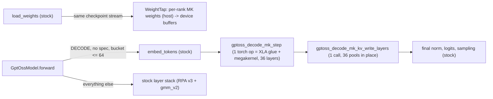

# GPT-OSS decode megakernel in SGLang serving

The standalone kernel is described in `DESIGN.md`. The opt-in serving integration lives in
`sglang_tpu/gptoss_decode_mk/`, exposed to `python/sglang/srt/models/gpt_oss.py` via the
`python/sglang/srt/hardware_backend/tpu/kernels/gptoss_decode_megakernel` shim with zero
added core TPU branches or plugin imports.

## Enabling & environment knobs

All environment variables are registered on `Envs` in `python/sglang/srt/environ.py`:

| Env var | Default | Meaning |
|---|---|---|
| `SGLANG_TPU_GPTOSS_DECODE_MK` | `0` | `1` enables the opt-in GPT-OSS TP8 decode megakernel |
| `SGLANG_TPU_GPTOSS_DECODE_MK_MOE` | `tp` | `tp`: each rank holds an `I/8` slice of all 128 experts; `ep`: 16 whole experts per rank |
| `SGLANG_TPU_GPTOSS_DECODE_MK_W_DTYPE` | `fp8` | `fp8` (`e4m3fn` + per-column power-of-2 scale, lossless from MXFP4) or `mxfp4` (in-VMEM dequant) |
| `SGLANG_TPU_GPTOSS_DECODE_MK_AR_MODE` | `auto` | `auto` (`oneshot` for `B <= 8`, `rsag` for `B >= 16`), `oneshot`, or `rsag` |
| `SGLANG_TPU_GPTOSS_DECODE_MK_AR_FOLD` | `1` | Fold small-batch (`B <= 4`) all-reduce payloads to live rows |
| `SGLANG_TPU_GPTOSS_DECODE_MK_NPB` | `16` | Full-attention KV pages per DMA work item (`16` pages = `1024` tokens) |
| `SGLANG_TPU_GPTOSS_DECODE_MK_NPB_SWA` | `3` | Sliding-window KV pages per DMA work item |
| `SGLANG_TPU_GPTOSS_DECODE_MK_KV_BUFS` | `4` | Number of pipelined KV page DMA buffers (`kv_bufs - 1` items in flight) |
| `SGLANG_TPU_GPTOSS_DECODE_MK_W_SLOTS` | `3` | Number of VMEM ring slots for streamed MoE expert chunks |
| `SGLANG_TPU_GPTOSS_DECODE_MK_VMEM_MIB` | `60` | Pallas `vmem_limit_bytes` in MiB |
| `SGLANG_TPU_GPTOSS_DECODE_MK_KV_WRITE` | `layers` | `layers` (single Pallas call aliasing all 36 pools) or `per_layer` (36 single-pool calls) |
| `SGLANG_TPU_GPTOSS_DECODE_MK_TIMING` | `0` | `1` enables periodic dynamo/eager-run diagnostic logging |
| `SGLANG_TPU_GPTOSS_DECODE_MK_ABLATE` | `""` | Timing-only serving ablations: `noop_kernel`, `no_kv_write`, `no_mk` (outputs invalid) |
| `SGLANG_TPU_GPTOSS_DECODE_MK_KERNEL_ABLATE` | `""` | Comma-separated kernel ablations (`ar,attn,attn_kv,moe,experts`; outputs invalid) |

## What runs where



- **Load time (`runtime.WeightTap`, `weights.MkWeightBuilder`):** `GptOssForCausalLM.load_weights`
  wraps its checkpoint iterator. Each tensor is copied into this rank's kernel layout before
  it is passed on to the stock loader:
  - MXFP4 experts are reshuffled into little-endian `uint32` words (`8` K codes per word, code `k`
    at bits `4k`), and `e8m0` scales become exact `bf16` powers of two.
  - `w13` rows are de-interleaved (`gate`/`up`), and in TP mode the `I` dim is split on whole
    32-row scale blocks.
  - By default (`w_dtype="fp8"`), `weights.mxfp4_to_fp8` converts the MXFP4 blocks offline to
    `fp8_e4m3fn` times a per-column power-of-two `bf16` scale and counts any inexact elements
    (`0` inexact blocks out of `18,432` on `openai/gpt-oss-120b`). If any element is inexact,
    the runner automatically falls back to `w_dtype="mxfp4"`.
  - A `bf16` checkpoint (`gate_up_proj` / `down_proj`) is quantized with the kernel reference's
    rule (lossless for weights dequantized from the MXFP4 release).
  - Host tensors are uploaded once as non-persistent buffers (`torch.uint32` for packed codes)
    on `model.model._tpu_decode_mk`. Stock weights remain in place for prefill/extend.
- **Decode (`runtime.GptOssDecodeMK.run`, `adapter.per_rank_step`):**
  - Consumes the RPA v3 backend's metadata (`kv_lens`, rectangular `page_indices`,
    `swa_page_indices`), the stock rotary `cos_sin_cache`, and the 36 per-layer fused KV pools
    `[pages, 64, 1, packing, 128]`.
  - `pos = kv_lens - 1`, `pt_full / pt_swa` are `[B, pages_per_seq]` page tables, window pages
    come from `pt_swa`, and the new token is written at `pt[pos // 64]` offset `pos % 64`
    (matching `out_cache_loc` and `full_to_swa[out_cache_loc]`).
  - Bucket-padding rows (`kv_lens == 0`) attend nothing and write the reserved page 0.

## Supported parallelism & configuration matrix

| Dimension | Supported by Decode Megakernel | Unsupported (Auto-Disables or Falls Back to Stock) |
|---|---|---|
| **Attention Parallelism** | `tp_size = 8` (`attn_tp_size == num_key_value_heads == 8`, 1 KV head/rank) | `tp_size != 8`, `attn_dp_size > 1`, `attn_cp_size > 1`, `attn_dcp_size > 1` (auto-disables at load) |
| **Pipeline Parallelism** | `pp_size = 1` (single call runs all 36 layers) | `pp_size > 1` (auto-disables at load) |
| **MoE Sharding** | Both `tp` (default) and `ep` (`SGLANG_TPU_GPTOSS_DECODE_MK_MOE=ep`); works with any server `--ep-size` (`1` or `8`) | — |
| **Expert Weight Dtype** | `fp8` (default) and `mxfp4`; accepts MXFP4 or `bf16` checkpoints | Non-HF GPT-OSS expert tensor layouts (auto-disables at load) |
| **KV Cache & Attention** | `pallas_tpu_rpa_v3` with hybrid SWA pool (`page_size = 64`), `kv_cache_dtype` in `{fp8_e4m3, bfloat16}`, unit KV scales | Non-hybrid pool, `page_size != 64`, non-unit KV scales |
| **Forward Mode & Batch** | Plain `ForwardMode.DECODE`, `1 <= padded_batch <= 64`, 1 token/req | `EXTEND` / `MIXED` / `IDLE` or `batch > 64` dynamically use stock layers; speculative decoding auto-disables at load |

## Design choices

| Topic | Choice | Rationale |
|---|---|---|
| Weight source | Tap the checkpoint stream in `load_weights` | Stock TP8/EP8 shards *whole experts*. TP-split MoE needs an `I/8` slice of all 128 experts, which is available in the streamed checkpoint before stock sharding drops other ranks' experts. |
| Weight memory & HBM budget | Separate copy: `+14.96 GiB/rank` (`fp8`, TP) / `+14.92 GiB/rank` (`fp8`, EP) or `+8.66 GiB/rank` (`mxfp4`, TP) / `+8.62 GiB/rank` (`mxfp4`, EP) | On TPU v7x (`96 GB` HBM/rank), stock weights (`~28.5 GB/rank`) + `fp8` MK weights (`14.96 GiB/rank`) total `~43.5 GB/rank` before KV cache allocation, leaving `> 50 GB/rank` for KV pools and activations. |
| KV pools | Kernel takes `18` SWA + `18` full **per-layer** pool operands (`split_pools=True`) | Stacking per-layer tensors would copy the pools every step, and `torch_tpu` requires each pool to remain its own base tensor for RPA donation. |
| KV write | Single non-collective Pallas call (`gptoss_decode_kv_scatter`) donating and aliasing all 36 pools (`Tensor(a!)` in the torch custom op schema); `has_side_effects=False` | XLA does not alias outputs of a `collective_id` `pallas_call` into live-out buffers, and `torch_tpu`'s SPMD partitioner rejects unsharded `has_side_effects=True` custom calls (`Side-effect HLO must have sharding`). Keeping the 36-pool write in one aliased non-collective op mutates all 36 pools in place with zero copies. |
| Genuine `torch.uint32` code words | Packed expert code words are uploaded as `torch.uint32` device tensors | Storing code words as `int32` caused XLA to emit `7.8 GB` `bitcast_convert` copies (`int32 -> uint32`) inside `shard_map` (`~4.5 ms/step` overhead). |
| RoPE | Gather the stock `cos_sin_cache` at `pos` (`bf16`, YaRN including `truncate: false`) | Preserves exact RoPE agreement with the stock attention layers. |

## Verification

### 1. CPU & Pallas Interpret Unit Tests (`test_gptoss_decode_mk_serving.py`, 23 tests)

| Check | Result |
|---|---|
| Checkpoint -> per-rank weights vs `megakernel.pack_weights` (`tp` & `ep`, `mxfp4`, `fp8`, and `bf16` checkpoints, all 8 ranks) | Bit-identical across all attention, router, norm, bias, and expert operands |
| SGLang decode metadata -> kernel operands (`_build_metadata_host` page tables, `full_to_swa` mapping, page boundaries, bucket padding) | Write slots match `out_cache_loc` / `full_to_swa[out_cache_loc]`; window pages and RoPE rows exact |
| End-to-end tiny decode step (`tp`/`fp8` KV/`fp8` experts and `ep`/`bf16` KV/`mxfp4` experts) vs `reference.step` | Relative error `3.5-3.6e-3`; only active rows' new-token slots and page 0 change |
| TPU lowering checks (`test_fp8_step_lowering`, `test_uint32_weights_and_noop_step_lowering`) | Zero `bitcast_convert` ops on weights; zero `has_side_effects` custom calls |
| `TestRunUnderTorchCompile` (`torch.compile(fullgraph=True)` on CPU) | Compiles with 0 graph breaks across all `TIMING x ABLATE x KV_WRITE` combinations |

### 2. TPU v7x (`2x2x1`, TP=8) End-to-End SGLang Serving (`openai/gpt-oss-120b`, `1024` in / `512` out, `ctx-len=32768`, `fp8` KV)

| Concurrency (`c`) | Num Prompts (`1024` in / `512` out) | Stock Median ITL | **MK Median ITL** | **ITL Speedup** | Stock Mean TPOT | **MK Mean TPOT** | **MK P99 ITL** | Stock Out `tok/s` | **MK Out `tok/s`** | Stock Total `tok/s` (In+Out) | **MK Total `tok/s` (In+Out)** | **Throughput Speedup** |
|---|---:|---:|---:|---:|---:|---:|---:|---:|---:|---:|---:|---:|
| **c=1** | 8 | 4.87 ms | **2.93 ms** | **1.66x** | 4.96 ms | **2.99 ms** | 3.63 ms | 197-203 | **320.79** | 591-609 | **962.37** | **1.61x** |
| **c=8** | 32 | 8.44 ms | **3.48 ms** | **2.43x** | 8.54 ms | **3.73 ms** | 6.18 ms | 883-900 | **1,844.90** | 2,649-2,701 | **5,534.70** | **2.09x** |
| **c=32** | 128 | 15.27 ms | **7.79 ms** | **1.96x** | 16.02 ms | **8.34 ms** | 8.61 ms | 1,875-1,928 | **3,397.30** | 5,625-5,784 | **10,191.90** | **1.78x** |
| **c=64** | 256 | 20.81 ms | **13.46 ms** | **1.55x** | 22.19 ms | **14.38 ms** | 15.27 ms | 2,704-2,747 | **4,005.01** | 8,112-8,241 | **12,015.03** | **1.47x** |

- **Accuracy (`gsm8k`, 200 questions, reasoning low):** **`0.970`** exact-match with `SGLANG_TPU_GPTOSS_DECODE_MK=1` vs **`0.960`** stock.
- **Determinism & compilation:** Back-to-back golden runs produce bit-identical greedy outputs across all 6 prompts; `0` dynamo graph breaks and `0` eager runs across `63,749` captured calls (`24` unique graphs).
- **Non-layer decode floor ablations (`SGLANG_TPU_GPTOSS_DECODE_MK_ABLATE`):**
  - `no_mk` (embed + final norm + `LogitsProcessor` + `TpuSampler` + host step, no layers): `2.61 / 3.02 / 4.07 / 4.55 ms` at `c=1/8/32/64`.
  - `noop_kernel` (+ operand marshalling + 36-pool KV write): `2.98 / 3.44 / 4.12 / 4.51 ms` (marshalling + KV write adds `<= 0.4 ms/step`).
  - HLO inspection via `benchmark/tpu/gptoss_decode_mk/hlo_big_ops.py` (dumped with `XLA_FLAGS="--xla_dump_to=... --xla_dump_hlo_as_text"`) confirms zero per-step pool or weight copies in the compiled decode graph.

## How to run

```bash
# CPU unit tests (8 virtual CPU devices)
XLA_FLAGS=--xla_force_host_platform_device_count=8 JAX_PLATFORMS=cpu \
  python -m unittest test.registered.unit.hardware_backend.tpu.test_gptoss_decode_mk_serving

# Serving on TPU v7x (2x2x1, TP=8) with the decode megakernel enabled
SGLANG_TPU_GPTOSS_DECODE_MK=1 bash benchmark/tpu/launch_server.sh
```
